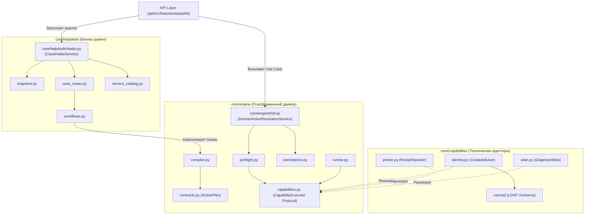

# 🏛️ Архитектурный план: Глобальный репакеджинг, Clean Architecture и система защиты от энтропии (Вариант 3)

## 1. Концепция и цели архитектурной реорганизации

В процессе масштабирования системы пакет [`core/automation/`](file:///c:/Users/belikov.a/Desktop/%D0%90%D0%BA%D1%82%D1%8B,%20%D0%B4%D0%BE%D0%BA%D1%83%D0%BC%D0%B5%D0%BD%D1%82%D1%8B/Work/%21Projects/intralink/core/automation/) (20 файлов) превратился в монолитный «комбайн», где в одной директории смешаны:
1. **Generic Workflow Engine (Платформенный движок оркестрации);**
2. **Helpdesk Business Domain (Прикладной домен службы поддержки и IntraService);**
3. **Infrastructure Adapters / Capabilities (Адаптеры к внешним системам: AD, WMI, SMB).**

Параллельно в контроллер API [`api/src/features/autopilot/service.py`](file:///c:/Users/belikov.a/Desktop/%D0%90%D0%BA%D1%82%D1%8B,%20%D0%B4%D0%BE%D0%BA%D1%83%D0%BC%D0%B5%D0%BD%D1%82%D1%8B/Work/%21Projects/intralink/api/src/features/autopilot/service.py) утекла доменная сага разрешения действий оператора (мутация `ActionPlan`, генерация новых хэшей, отмена старого плана и перезапуск preflight).

### Цели реализации Варианта 3:
* **Физическое разделение ответственности (Separation of Concerns):** Разложить кодовую базу на 3 четко изолированных пакета первого уровня с однонаправленным потоком зависимостей.
* **100% Domain-Agnostic Engine:** Платформенный движок не содержит упоминаний тикетов, заявителей, Active Directory или каталогов IntraService.
* **Тонкий API-слой:** Сага разрешения действий оператора переносится в выделенный сервис ядра `HumanActionResolutionService`.
* **Zero-Breakage Facade:** Пакет `core/automation` сохраняется как фасад обратной совместимости, исключая сбои внешних потребителей.
* **Система долговременного архитектурного контроля (Anti-Erosion & Governance):** Комплекс инструментов (Ruff, AST ArchUnit, лимиты сложности файлов, инварианты памяти), гарантирующих, что архитектура **не будет захламляться в дальнейшем**.

---

## 2. Целевая топология пакетов (Package Topology Map)

```text
core/
│
├── engine/                            # ⚙️ ПЛАТФОРМЕННЫЙ ДВИЖОК ОРКЕСТРАЦИИ (Generic Workflow Engine)
│   ├── __init__.py                    # Экспорт движка
│   ├── contracts.py                   # ActionPlan, ActionPlanAction, WorkflowPlan, ActionPlanState
│   ├── capabilities.py                # CapabilitySpec, CapabilityPreflight, CapabilityExecution, Registry, Protocol
│   ├── hitl.py                        # HumanActionProposal, HumanActionCandidate, HumanActionResolutionService
│   ├── preflight.py                   # ActionPreflightService (чистый, domain-agnostic)
│   ├── runner.py                      # CapabilityRunner (исполнение графа шагов)
│   ├── compiler.py                    # PlanCompiler (компиляция графов действий)
│   ├── persistence.py                 # WorkflowPersistenceService (сохранение планов и состояний)
│   ├── policy.py                      # ExecutionPolicyEngine (политики рисков и допусков)
│   └── replay.py                      # ReplayEngine (воспроизведение и аудит)
│
├── helpdesk/                          # 🎫 ПРИКЛАДНОЙ ДОМЕН СЛУЖБЫ ПОДДЕРЖКИ (Helpdesk Domain)
│   ├── __init__.py                    # Экспорт доменных сервисов
│   ├── snapshot.py                    # TicketSnapshot, TicketSnapshotFactory, TicketComment
│   ├── intake.py                      # Ticket Intake & Routing Orchestrator
│   ├── case_profiles.py               # Описания сценариев онбординга, печати, Wi-Fi
│   ├── case_router.py                 # Классификация заявок и выбор сценария
│   ├── case_verifier.py               # Верификация фактов заявки
│   ├── clarification.py               # ClarificationConvergenceService (диалоговый цикл, CAS generation)
│   ├── frame_extractor.py             # Извлечение сущностей (ФИО, ПК, должности)
│   ├── service_catalog.py             # Каталог услуг IntraService
│   ├── service_routing.py             # Маршрутизатор заявок по сервисам (05 Directum, etc.)
│   ├── workflows.py                   # Спецификации пайплайнов Helpdesk
│   └── llm_transport.py               # AI-транспорт извлечения структурированных данных
│
├── capabilities/                      # 🔌 ТЕХНИЧЕСКИЕ АДАПТЕРЫ ВОЗМОЖНОСТЕЙ (Capability Adapters)
│   ├── __init__.py                    # Регистрация стандартных экзекуторов
│   ├── identity.py                    # CreateAdUser, ResetAdPassword, UnlockAdAccount (реализует Protocol)
│   ├── printer.py                     # Spooler, PortCheck (WMI/WinRM)
│   └── wlan.py                        # WLAN Profile & Certs
│
└── automation/                        # 🔄 ФАСАД ОБРАТНОЙ СОВМЕСТИМОСТИ (Zero-Breakage Facade)
    └── __init__.py                    # Реэкспорт всех символов из engine, helpdesk, capabilities
```

### Матрица миграции файлов:

| Исходный файл (`core/automation/`) | Целевой модуль | Архитектурная зона |
| :--- | :--- | :--- |
| `capabilities.py` | [`core/engine/capabilities.py`](file:///c:/Users/belikov.a/Desktop/%D0%90%D0%BA%D1%82%D1%8B,%20%D0%B4%D0%BE%D0%BA%D1%83%D0%BC%D0%B5%D0%BD%D1%82%D1%8B/Work/%21Projects/intralink/core/engine/capabilities.py) | Engine (Контракты возможностей и реестр) |
| `contracts.py` | [`core/engine/contracts.py`](file:///c:/Users/belikov.a/Desktop/%D0%90%D0%BA%D1%82%D1%8B,%20%D0%B4%D0%BE%D0%BA%D1%83%D0%BC%D0%B5%D0%BD%D1%82%D1%8B/Work/%21Projects/intralink/core/engine/contracts.py) | Engine (Модели планов действий) |
| `preflight.py` | [`core/engine/preflight.py`](file:///c:/Users/belikov.a/Desktop/%D0%90%D0%BA%D1%82%D1%8B,%20%D0%B4%D0%BE%D0%BA%D1%83%D0%BC%D0%B5%D0%BD%D1%82%D1%8B/Work/%21Projects/intralink/core/engine/preflight.py) | Engine (Оркестрация проверок) |
| `runner.py` | [`core/engine/runner.py`](file:///c:/Users/belikov.a/Desktop/%D0%90%D0%BA%D1%82%D1%8B,%20%D0%B4%D0%BE%D0%BA%D1%83%D0%BC%D0%B5%D0%BD%D1%82%D1%8B/Work/%21Projects/intralink/core/engine/runner.py) | Engine (Выполнение шагов) |
| `compiler.py` | [`core/engine/compiler.py`](file:///c:/Users/belikov.a/Desktop/%D0%90%D0%BA%D1%82%D1%8B,%20%D0%B4%D0%BE%D0%BA%D1%83%D0%BC%D0%B5%D0%BD%D1%82%D1%8B/Work/%21Projects/intralink/core/engine/compiler.py) | Engine (Компиляция планов) |
| `persistence.py` | [`core/engine/persistence.py`](file:///c:/Users/belikov.a/Desktop/%D0%90%D0%BA%D1%82%D1%8B,%20%D0%B4%D0%BE%D0%BA%D1%83%D0%BC%D0%B5%D0%BD%D1%82%D1%8B/Work/%21Projects/intralink/core/engine/persistence.py) | Engine (Хранение планов) |
| `policy.py` | [`core/engine/policy.py`](file:///c:/Users/belikov.a/Desktop/%D0%90%D0%BA%D1%82%D1%8B,%20%D0%B4%D0%BE%D0%BA%D1%83%D0%BC%D0%B5%D0%BD%D1%82%D1%8B/Work/%21Projects/intralink/core/engine/policy.py) | Engine (Политики рисков) |
| `replay.py` | [`core/engine/replay.py`](file:///c:/Users/belikov.a/Desktop/%D0%90%D0%BA%D1%82%D1%8B,%20%D0%B4%D0%BE%D0%BA%D1%83%D0%BC%D0%B5%D0%BD%D1%82%D1%8B/Work/%21Projects/intralink/core/engine/replay.py) | Engine (Аудит и реплей) |
| *Новый* | [`core/engine/hitl.py`](file:///c:/Users/belikov.a/Desktop/%D0%90%D0%BA%D1%82%D1%8B,%20%D0%B4%D0%BE%D0%BA%D1%83%D0%BC%D0%B5%D0%BD%D1%82%D1%8B/Work/%21Projects/intralink/core/engine/hitl.py) | Engine (`HumanActionResolutionService` + DTO) |
| `snapshot.py` | [`core/helpdesk/snapshot.py`](file:///c:/Users/belikov.a/Desktop/%D0%90%D0%BA%D1%82%D1%8B,%20%D0%B4%D0%BE%D0%BA%D1%83%D0%BC%D0%B5%D0%BD%D1%82%D1%8B/Work/%21Projects/intralink/core/helpdesk/snapshot.py) | Helpdesk Domain (Снимки тикетов) |
| `intake.py` | [`core/helpdesk/intake.py`](file:///c:/Users/belikov.a/Desktop/%D0%90%D0%BA%D1%82%D1%8B,%20%D0%B4%D0%BE%D0%BA%D1%83%D0%BC%D0%B5%D0%BD%D1%82%D1%8B/Work/%21Projects/intralink/core/helpdesk/intake.py) | Helpdesk Domain (Оркестрация анализа) |
| `case_profiles.py` | [`core/helpdesk/case_profiles.py`](file:///c:/Users/belikov.a/Desktop/%D0%90%D0%BA%D1%82%D1%8B,%20%D0%B4%D0%BE%D0%BA%D1%83%D0%BC%D0%B5%D0%BD%D1%82%D1%8B/Work/%21Projects/intralink/core/helpdesk/case_profiles.py) | Helpdesk Domain (Профили сценариев) |
| `case_router.py` | [`core/helpdesk/case_router.py`](file:///c:/Users/belikov.a/Desktop/%D0%90%D0%BA%D1%82%D1%8B,%20%D0%B4%D0%BE%D0%BA%D1%83%D0%BC%D0%B5%D0%BD%D1%82%D1%8B/Work/%21Projects/intralink/core/helpdesk/case_router.py) | Helpdesk Domain (Классификация) |
| `case_verifier.py` | [`core/helpdesk/case_verifier.py`](file:///c:/Users/belikov.a/Desktop/%D0%90%D0%BA%D1%82%D1%8B,%20%D0%B4%D0%BE%D0%BA%D1%83%D0%BC%D0%B5%D0%BD%D1%82%D1%8B/Work/%21Projects/intralink/core/helpdesk/case_verifier.py) | Helpdesk Domain (Верификация кейса) |
| `clarification.py` | [`core/helpdesk/clarification.py`](file:///c:/Users/belikov.a/Desktop/%D0%90%D0%BA%D1%82%D1%8B,%20%D0%B4%D0%BE%D0%BA%D1%83%D0%BC%D0%B5%D0%BD%D1%82%D1%8B/Work/%21Projects/intralink/core/helpdesk/clarification.py) | Helpdesk Domain (Диалоговый цикл) |
| `frame_extractor.py` | [`core/helpdesk/frame_extractor.py`](file:///c:/Users/belikov.a/Desktop/%D0%90%D0%BA%D1%82%D1%8B,%20%D0%B4%D0%BE%D0%BA%D1%83%D0%BC%D0%B5%D0%BD%D1%82%D1%8B/Work/%21Projects/intralink/core/helpdesk/frame_extractor.py) | Helpdesk Domain (Извлечение фактов) |
| `service_catalog.py` | [`core/helpdesk/service_catalog.py`](file:///c:/Users/belikov.a/Desktop/%D0%90%D0%BA%D1%82%D1%8B,%20%D0%B4%D0%BE%D0%BA%D1%83%D0%BC%D0%B5%D0%BD%D1%82%D1%8B/Work/%21Projects/intralink/core/helpdesk/service_catalog.py) | Helpdesk Domain (Каталог услуг) |
| `service_routing.py` | [`core/helpdesk/service_routing.py`](file:///c:/Users/belikov.a/Desktop/%D0%90%D0%BA%D1%82%D1%8B,%20%D0%B4%D0%BE%D0%BA%D1%83%D0%BC%D0%B5%D0%BD%D1%82%D1%8B/Work/%21Projects/intralink/core/helpdesk/service_routing.py) | Helpdesk Domain (Маршрутизация) |
| `workflows.py` | [`core/helpdesk/workflows.py`](file:///c:/Users/belikov.a/Desktop/%D0%90%D0%BA%D1%82%D1%8B,%20%D0%B4%D0%BE%D0%BA%D1%83%D0%BC%D0%B5%D0%BD%D1%82%D1%8B/Work/%21Projects/intralink/core/helpdesk/workflows.py) | Helpdesk Domain (Шаблоны графов) |
| `llm_transport.py` | [`core/helpdesk/llm_transport.py`](file:///c:/Users/belikov.a/Desktop/%D0%90%D0%BA%D1%82%D1%8B,%20%D0%B4%D0%BE%D0%BA%D1%83%D0%BC%D0%B5%D0%BD%D1%82%D1%8B/Work/%21Projects/intralink/core/helpdesk/llm_transport.py) | Helpdesk Domain (Интерфейс к LLM) |
| `executors/identity.py` | [`core/capabilities/identity.py`](file:///c:/Users/belikov.a/Desktop/%D0%90%D0%BA%D1%82%D1%8B,%20%D0%B4%D0%BE%D0%BA%D1%83%D0%BC%D0%B5%D0%BD%D1%82%D1%8B/Work/%21Projects/intralink/core/capabilities/identity.py) | Capabilities (AD Provisioning & HITL OU) |
| `executors/printer.py` | [`core/capabilities/printer.py`](file:///c:/Users/belikov.a/Desktop/%D0%90%D0%BA%D1%82%D1%8B,%20%D0%B4%D0%BE%D0%BA%D1%83%D0%BC%D0%B5%D0%BD%D1%82%D1%8B/Work/%21Projects/intralink/core/capabilities/printer.py) | Capabilities (WMI/WinRM Принтеры) |
| `executors/wlan.py` | [`core/capabilities/wlan.py`](file:///c:/Users/belikov.a/Desktop/%D0%90%D0%BA%D1%82%D1%8B,%20%D0%B4%D0%BE%D0%BA%D1%83%D0%BC%D0%B5%D0%BD%D1%82%D1%8B/Work/%21Projects/intralink/core/capabilities/wlan.py) | Capabilities (Wi-Fi Сертификаты) |

---

## 3. Граф зависимостей и архитектурные инварианты



---

## 4. 🛡️ Система долговременного контроля и защиты от архитектурной энтропии (Anti-Erosion & Governance)

Для того чтобы архитектура **гарантированно не захламлялась в будущем**, в проект внедряется 4-уровневый автоматизированный контур контроля:

### Уровень 1: Статический анализ Ruff (`ruff.toml`)
В конфигурацию линтера добавляются жесткие правила `flake8-tidy-imports.banned-api` для платформенного движка:
```toml
# Запрет импорта доменных и внешних модулей в ядре оркестрации
[lint.flake8-tidy-imports.banned-api]
"core.helpdesk".msg = "Платформенный движок core/engine не должен зависеть от прикладного домена helpdesk!"
"core.capabilities".msg = "Платформенный движок core/engine не должен зависеть от адаптеров capabilities!"
"core.ad".msg = "Платформенный движок core/engine не должен зависеть от инфраструктурного пакета core/ad!"
```
Линтер срабатывает мгновенно при наборе кода в IDE и блокирует коммит.

### Уровень 2: Архитектурные тесты ArchUnit (`core/tests/test_architectural_boundaries.py`)
Автоматический запуск в `pytest` с четырьмя автоматическими инвариантами:
1. **Unidirectional Dependency Graph:** Тест сканирует AST и верифицирует, что граф импортов строго ацикличен и однонаправлен (`API -> helpdesk -> engine <- capabilities`).
2. **God-Object & File Length Budget Guard:** Ограничение на разрастание «файлов-комбайнов». Если файл сервиса превышает 600 строк кода, тест требует декомпозиции на субсервисы, предотвращая появление монолитов.
3. **Capability Protocol Completeness Guard:** Сканирует все классы в `core/capabilities/` и верифицирует, что они реализуют все обязательные методы протокола (`preflight`, `execute`, `validate_human_action`) с типизированными сигнатурами.
4. **Domain Literals Linter:** AST-поиск строковых литералов Active Directory (`ou_candidates`, `target_ou_dn`, `users_root_ou`) внутри `core/engine/` с запретом их использования.

### Уровень 3: Шаблоны расширения (Capability & Case Scaffolding)
Чтобы новые фичи не привносили хаос, в документацию и тесты закладывается стандарт расширения:
* Добавление новой возможности оформляется строго как класс-наследник `CapabilityExecutor` в `core/capabilities/` с явной регистрацией в реестре;
* Добавление нового сценария службы поддержки оформляется строго в `core/helpdesk/case_profiles.py` и `workflows.py`.

### Уровень 4: Контекстная память агента (`GEMINI.md`)
Фиксация архитектурных границ в постоянной памяти AI-агента Antigravity:
* Агент автоматически предупреждает разработчика при попытке нарушить границы слоев;
* Запрещена генерация бизнес-логики саг внутри контроллеров API.

---

## 5. Пошаговый план миграции (Phased Execution Plan)

### Фаза 1. Выделение Generic Workflow Engine (`core/engine/`)
1. Создать пакет [`core/engine/`](file:///c:/Users/belikov.a/Desktop/%D0%90%D0%BA%D1%82%D1%8B,%20%D0%B4%D0%BE%D0%BA%D1%83%D0%BC%D0%B5%D0%BD%D1%82%D1%8B/Work/%21Projects/intralink/core/engine/):
   - Перенести `contracts.py`, `compiler.py`, `runner.py`, `persistence.py`, `policy.py`, `replay.py`.
   - В `capabilities.py`:
     - Добавить строгие модели `HumanActionCandidate` и `HumanActionProposal` (`extra="forbid", frozen=True`).
     - Добавить в `CapabilityPreflight` типизированное поле `human_action: HumanActionProposal | None = None`.
     - Добавить в `CapabilityExecutor` протокольный метод `async def validate_human_action(self, target_param: str, value: Any) -> bool: ...`.
2. В `core/engine/preflight.py`:
   - Полностью очистить оркестратор от специфики AD (`ou_candidates`, `target_ou_dn`, тексты подсказок).
   - Материализовать `HumanActionRequestRecord` строго и универсально из `result.human_action`.
3. Создать `core/engine/hitl.py`:
   - Реализовать класс `HumanActionResolutionService`:
     ```python
     class HumanActionResolutionService:
         def __init__(self, repository, preflight, capabilities_registry): ...
         async def resolve(self, session, *, ticket_id, human_action_id, candidate_id, operator, ...): ...
     ```
   - Инкапсулировать полную сагу: валидация через экзекутор ➔ мутация плана ➔ пересчет хэшей ➔ отмена старого плана ➔ сохранение ➔ вызов `preflight.run_plan()`.

### Фаза 2. Выделение Capability Adapters (`core/capabilities/`)
1. Создать пакет [`core/capabilities/`](file:///c:/Users/belikov.a/Desktop/%D0%90%D0%BA%D1%82%D1%8B,%20%D0%B4%D0%BE%D0%BA%D1%83%D0%BC%D0%B5%D0%BD%D1%82%D1%8B/Work/%21Projects/intralink/core/capabilities/):
   - Перенести `identity.py`, `printer.py`, `wlan.py`.
2. В `core/capabilities/identity.py`:
   - При нехватке/неоднозначности OU в методе `preflight()` экзекутор `CreateAdUserExecutor` сам формирует `HumanActionProposal` с кандидатами OU и локализованным промптом.
   - Реализовать метод `validate_human_action("target_ou_dn", value)`: проверка синтаксиса DN и `_is_descendant(value, users_root_ou)`.
3. В `core/capabilities/__init__.py`:
   - Предоставить фабрику создания дефолтного `CapabilityRegistry` со всеми зарегистрированными адаптерами.

### Фаза 3. Выделение Helpdesk Domain (`core/helpdesk/`)
1. Создать пакет [`core/helpdesk/`](file:///c:/Users/belikov.a/Desktop/%D0%90%D0%BA%D1%82%D1%8B,%20%D0%B4%D0%BE%D0%BA%D1%83%D0%BC%D0%B5%D0%BD%D1%82%D1%8B/Work/%21Projects/intralink/core/helpdesk/):
   - Перенести `snapshot.py`, `intake.py`, `case_profiles.py`, `case_router.py`, `case_verifier.py`, `clarification.py`, `frame_extractor.py`, `service_catalog.py`, `service_routing.py`, `workflows.py`, `llm_transport.py`.
2. Обновить внутренние импорты домена на `core.engine.*` (планы, компилятор, контракты).

### Фаза 4. Формирование Facade-слоя (`core/automation/__init__.py`)
1. Превратить старый пакет `core/automation` в тонкий слой обратной совместимости.
2. В `core/automation/__init__.py` и дочерних stub-файлах (при необходимости) реэкспортировать все классы и функции из `core.engine`, `core.helpdesk`, `core.capabilities`.
3. За счет этого существующие импорты во всем репозитории продолжат работать без единой ошибки на этапе миграции.

### Фаза 5. Рефакторинг API-контроллера Autopilot
1. В [`api/src/features/autopilot/service.py`](file:///c:/Users/belikov.a/Desktop/%D0%90%D0%BA%D1%82%D1%8B,%20%D0%B4%D0%BE%D0%BA%D1%83%D0%BC%D0%B5%D0%BD%D1%82%D1%8B/Work/%21Projects/intralink/api/src/features/autopilot/service.py):
   - Удалить 80 строк процедурной логики мутации плана и LDAP-проверок из метода `resolve_human_action`.
   - Подключить `HumanActionResolutionService`:
     ```python
     corrected_plan = await self.human_action_service.resolve(
         session,
         ticket_id=ticket_id,
         human_action_id=human_action_id,
         candidate_id=request.candidate_id,
         generation=request.generation,
         snapshot_hash=request.snapshot_hash,
         plan_hash=request.plan_hash,
         operator=operator,
     )
     ```
   - Метод контроллера сокращается до чистой валидации HTTP-запроса и возврата DTO.

### Фаза 6. Внедрение щита долговременного контроля
1. Настроить `ruff.toml` с `banned-api` для `core/engine/`.
2. Реализовать полный комплекс проверок в [`core/tests/test_architectural_boundaries.py`](file:///c:/Users/belikov.a/Desktop/%D0%90%D0%BA%D1%82%D1%8B,%20%D0%B4%D0%BE%D0%BA%D1%83%D0%BC%D0%B5%D0%BD%D1%82%D1%8B/Work/%21Projects/intralink/core/tests/test_architectural_boundaries.py).
3. Верифицировать падение тестов при искусственных попытках нарушения любого из 4 законов.

### Фаза 7. Обновление документации и памяти проекта
1. Обновить [`GEMINI.md`](file:///c:/Users/belikov.a/Desktop/%D0%90%D0%BA%D1%82%D1%8B,%20%D0%B4%D0%BE%D0%BA%D1%83%D0%BC%D0%B5%D0%BD%D1%82%D1%8B/Work/%21Projects/intralink/GEMINI.md):
   - Добавить раздел «Инварианты слоистой архитектуры ядра (Clean Architecture v2)».
   - Зафиксировать правила AST-тестирования и лимиты размера файлов.
2. Создать архитектурное решение ADR 0007: `docs/adr/0007-clean-architecture-engine-repackaging.md`.

---

## 6. План верификации и критерии приемки

| Этап | Инструмент проверки | Критерий успешности |
| :--- | :--- | :--- |
| **Ruff Architectural Lint** | `ruff check .` | 0 ошибок. Запрещенные доменные импорты в `core/engine/` блокируются. |
| **AST-контроль границ** | `pytest core/tests/test_architectural_boundaries.py` | 100% архитектурных проверок пройдены (однонаправленность, протоколы, литералы). |
| **Регрессия тестов ядра** | `pytest core/tests/` | Все 140+ тестов ядра проходят без сбоев. |
| **Полный регресс бэкенда** | `pytest core/tests/ worker/tests/ api/tests/` | **223 из 223 тестов** пройдены успешно (`exit code 0`). |
| **Фронтенд и Server-Driven UI** | `npm run build` в `web/` | Сборка компилируется без ошибок (`exit code 0`). |
| **Тестирование HITL саги** | Специализированный тест разрешения OU | Проверка валидного выбора OU, проверка невалидного OU (отклонение 422), проверка конфликта генераций (409). |
