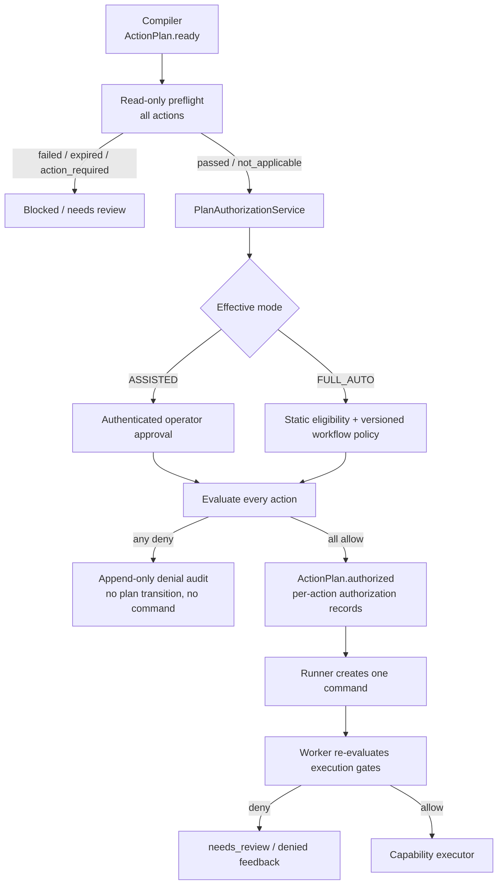

# Единый план рефакторинга конвейера автоматизации

> **Ветка:** `codex/adr-0006-case-workflow-capabilities`
> **Статус документа:** исправленная архитектурная версия, готова к реализации
> **Направления:** versioned ASSISTED/FULL_AUTO authorization + fail-closed gates + неизменяемый audit trail
> **Безопасный default:** после миграции все workflow остаются в `ASSISTED`; сам факт реализации не активирует FULL_AUTO

---

## 1. Контекст и граница изменения

Текущий ADR 0006 поддерживает только операторский путь:

```text
compile -> ActionPlan.ready -> preflight -> operator approve
        -> ActionPlan.approved -> command -> execution policy -> executor
```

В реализации есть три отдельных дефекта:

1. `ActionProposal.requires_approval` всегда равен `True`, а выбор состояния workflow частично зависит от строкового ключа workflow.
2. `params_valid = bool(canonical_params_hash(...))` является тавтологией и не проверяет соответствие параметров.
3. Повторный AD service gate выполняется после policy decision и поэтому не входит в хэшированное решение аудита.

Цель изменения — добавить **автоматическую авторизацию уже построенного ActionPlan**, не смешивая её с компиляцией и не ослабляя execution gates.

### Что означает FULL_AUTO в этом этапе

`FULL_AUTO` здесь означает только автоматическую авторизацию и запуск ActionPlan после явного анализа и успешного preflight. Poller остаётся read-only и не начинает анализ/исполнение по назначению сервисной учётной записи.

Полностью автономный intake из очереди является отдельным этапом и требует отдельного ADR.

### Вне scope

- автоматический анализ новых заявок poller-ом;
- shadow/dual-write/legacy fallback;
- автоматическое включение FULL_AUTO миграцией;
- FULL_AUTO для `create_ad_user`, `disable_ad_user`, `install_printer`;
- FULL_AUTO для печатных инцидентов до появления persisted diagnostic evidence;
- изменение поведения `unknown_outcome`: оно по-прежнему переводит план в `needs_review` без автоматического retry/compensation.

---

## 2. Непереговорные инварианты

1. Compiler создаёт только предложение: он никогда не выставляет `approved`, `authorized` или `running`.
2. Runner принимает только `authorized/running`; он никогда не повышает `ready` самостоятельно.
3. И операторский, и автоматический путь используют один `PlanAuthorizationService` и одинаковые preflight/policy/binding проверки.
4. Для каждого action существует отдельное неизменяемое authorization decision, привязанное к plan/action/snapshot/params и ревизиям политик.
5. Многошаговый план может получить `POLICY_AUTO` только если **все** actions допускают автоматическое выполнение. Смешанный план целиком остаётся `ASSISTED`.
6. Любой mutating action, требующий service binding, fail-closed при отсутствующем, неактивном, невалидированном или изменившемся binding.
7. Только свежие preflight со статусом `passed` или `not_applicable` допускают авторизацию и исполнение.
8. Любое изменение snapshot, params, plan hash, capability/workflow policy revision или binding после авторизации запрещает исполнение.
9. Decision record не изменяется после вставки. `context_hash` и `decision_hash` всегда соответствуют сохранённым `allowed/reasons`.
10. `MUTATING_AUTOMATION_FORCE_DISABLED` API и Worker остаются независимыми fail-closed ceilings.
11. LLM, текст заявки, confidence и назначение бота сами по себе не авторизуют мутацию.
12. Секреты не попадают в планы, команды, decisions, feedback, комментарии и логи.

---

## 3. Целевая архитектура



### Разделение ответственности

| Компонент | Ответственность |
|---|---|
| `WorkflowCompiler` | Детерминированно построить workflow/action plan и статическую eligibility; не авторизовать |
| `ActionPreflightService` | Выполнить read-only проверки и сохранить evidence |
| `PlanAuthorizationService` | Определить ASSISTED/FULL_AUTO, проверить все actions, записать decisions и атомарно авторизовать план |
| `WorkflowRunner` | Последовательно создавать команды только для уже авторизованного плана |
| `ExecutionPolicyEvaluator` | Сформировать полное хэшированное решение authorization/execution без доменных импортов |
| `command_dispatcher` | Собрать свежий runtime context и выполнить capability только после финального allow |

---

## 4. Контракты eligibility и runtime mode

### 4.1. `CapabilitySpec`

**Файл:** `core/automation/capabilities.py`

Добавить два декларативных поля:

```python
class CapabilitySpec(BaseModel):
    ...
    auto_execution_eligible: bool = False
    requires_service_binding: bool = False

    @model_validator(mode="after")
    def validate_auto_execution(self) -> "CapabilitySpec":
        if self.auto_execution_eligible:
            if self.risk == CapabilityRisk.high:
                raise ValueError("high_risk_capability_cannot_be_auto")
            if self.idempotency == IdempotencyMode.never_auto_retry:
                raise ValueError("never_auto_retry_capability_cannot_be_auto")
            if not self.verifies_result:
                raise ValueError("unverified_capability_cannot_be_auto")
        if self.is_mutating and not self.requires_service_binding:
            raise ValueError("mutating_capability_requires_service_binding")
        return self
```

Начальная матрица eligibility:

| Capability | Auto eligible | Requires binding | Обоснование |
|---|---:|---:|---|
| `probe_host` | да | нет | read-only |
| `probe_printer` | да | нет | read-only |
| `reset_print_spooler` | да | да | eligibility capability; workflow пока ASSISTED |
| `set_default_printer` | да | да | eligibility capability; workflow пока ASSISTED |
| `add_wlan_group_member` | да | да | идемпотентно, но включение только после acceptance |
| `install_printer` | нет | да | требуется подтверждённая диагностика/подготовка |
| `create_ad_user` | нет | да | high + never_auto_retry |
| `disable_ad_user` | нет | да | high impact |

`auto_execution_eligible=True` означает только техническую допустимость. Оно не включает FULL_AUTO.

### 4.2. `WorkflowDefinition`

**Файл:** `core/automation/workflows.py`

```python
class WorkflowDefinition(BaseModel):
    ...
    auto_execution_eligible: bool = False
```

Начальная матрица:

| Workflow | Auto eligible | Runtime seed | Причина |
|---|---:|---|---|
| `wireless_access_workflow` | да | `ASSISTED` | единственный кандидат первого controlled rollout |
| `printing_incident_workflow` | нет | `ASSISTED` | diagnostic capabilities пока не образуют persisted diagnostic gate |
| `printer_connection_workflow` | нет | `ASSISTED` | диагностика и мутация ПК |
| `employee_onboarding_workflow` | нет | `ASSISTED` | high-risk AD provisioning |
| `access_revocation_workflow` | нет | `ASSISTED` | high-impact disable |
| manual/consult/diagnostic workflows | нет | `ASSISTED` | отсутствует исполнимый ActionPlan |

### 4.3. `ActionProposal.requires_approval`

Поле сохраняется для API/UI, но получает точную семантику:

```text
True  -> action всегда требует operator authorization
False -> action лишь допускает POLICY_AUTO при наличии runtime policy FULL_AUTO
```

Compiler вычисляет его только из статической eligibility:

```python
requires_approval = not (
    definition.auto_execution_eligible
    and capability.auto_execution_eligible
)
```

Compiler всегда создаёт `ActionPlan.state=ready` и workflow в состоянии `ready_for_authorization`. Состояние `authorized` может выставить только `PlanAuthorizationService`.

В `core/automation/contracts.py` добавить `ActionPlanState.authorized` и `WorkflowPlanState.ready_for_authorization/authorized`. Старое `ActionPlanState.approved` больше не является исполнимым состоянием; operator approval — это один из видов authorization, а не особый обход policy. Поля `approved_by/approved_at` сохраняются только как операторские audit metadata и не используются для вывода права на выполнение.

---

## 5. Versioned workflow execution policy

Capability policy остаётся kill switch (`enabled/disabled`). Для режима выполнения добавить отдельную versioned policy по workflow.

### 5.1. Миграция `0011_workflow_execution_authorization.py`

Создать:

```text
workflow_execution_modes
  workflow_key PK
  desired_mode        ASSISTED | FULL_AUTO
  revision            int
  reason              text
  changed_by          text
  changed_at          timestamptz

workflow_execution_mode_events
  id PK
  workflow_key
  previous_mode
  new_mode
  revision
  reason
  changed_by
  created_at
```

Seed: все зарегистрированные workflow получают `ASSISTED`, revision `1`. Миграция никогда не создаёт `FULL_AUTO`.

Расширить `execution_policy_decisions`:

- `action_id` — action, к которому относится решение;
- `authorization_kind` — `operator` или `policy_auto` для phase=`authorization`;
- `workflow_policy_revision`;
- `context_json` — санитизированный canonical context, по которому можно независимо пересчитать `context_hash`;
- существующий `policy_revision` продолжает означать revision capability policy.

Обобщить поля `commands` clean-break rename-миграцией:

```text
approval_policy_decision_id -> authorization_decision_id
approval_policy_revision    -> authorization_capability_policy_revision
approval_policy_hash        -> authorization_decision_hash
+ authorization_workflow_policy_revision
```

Исторические approval decisions пометить `authorization_kind=operator`; старый phase `approval` преобразовать в `authorization`. Для исторических решений `context_json` допускается `NULL` как признак legacy audit, но новые решения обязаны иметь `action_id` и непустой `context_json`.

Перед миграцией требуется drain активных команд. Старые `approved` планы без action-specific authorization переводятся в `needs_review` и требуют повторного анализа/авторизации; миграция не должна синтетически создавать им разрешающие decisions.

### 5.2. Административный API

Добавить revision-aware endpoint изменения режима workflow с optimistic locking:

```http
PATCH /api/v2/admin/automation/workflows/{workflow_key}/mode
{
  "desired_mode": "ASSISTED | FULL_AUTO",
  "expected_revision": 3,
  "reason": "..."
}
```

Перевод в `FULL_AUTO` отклоняется, если нарушена статическая конфигурация:

- workflow отсутствует или `auto_execution_eligible=False`;
- хотя бы одна разрешённая mutating capability не auto eligible;

Динамические условия — capability policy, binding, force-disable и worker heartbeat — не запрещают сохранить желаемый режим, но оставляют его в состоянии `configured_not_active`. Они проверяются заново при каждой authorization/execution и отображаются как blockers. Это позволяет безопасно настроить FULL_AUTO, пока deployment ceiling ещё включён.

Все изменения режима записываются в append-only event table. Конкурирующая revision возвращает `409`.

---

## 6. Compiler и service binding

**Файл:** `core/automation/compiler.py`

Убрать approval-специфичный хардкод, но не запрещать все workflow literals: `employee_onboarding_workflow` остаётся допустимым в доменной AD authorization проверке, пока она не вынесена отдельно.

Перед созданием любого mutating ActionPlan выполнить общий fail-closed binding check:

```python
if capability.requires_service_binding:
    authorized = bool(
        compatibility
        and compatibility.state == ServiceCompatibilityState.compatible
        and binding
        and binding.is_active
        and binding.is_validated
        and binding.catalog_hash == compatibility.catalog_hash
        and compatibility.source_service_id in binding.service_ids
        and definition.key in binding.allowed_workflows
        and decision.primary_case_type in binding.allowed_case_types
        and capability.key in binding.allowed_capabilities
    )
    if not authorized:
        return needs_review("service_binding_not_authorized"), None
```

Специфичные требования `create_ad_user` — `ad_account_creation`, task type, required fields и delivery policy — остаются дополнительным, а не единственным gate.

---

## 7. Единый `PlanAuthorizationService`

**Новый файл:** `core/automation/authorization.py`

### 7.1. Вход

```python
AuthorizationKind = Literal["operator", "policy_auto"]

authorize(
    session,
    *,
    action_plan_id,
    expected_plan_hash,
    expected_snapshot_hash,
    kind,
    actor,
    current_snapshot_hash,
) -> AuthorizedPlanResult
```

### 7.2. Алгоритм одной транзакции

1. Заблокировать `ActionPlanRecord FOR UPDATE`.
2. Загрузить и проверить канонический persisted `plan_json`, `plan_hash`, snapshot и состояние `ready`.
3. Заблокировать capability policies всех actions и workflow mode policy.
4. Проверить текущий service/catalog binding для каждого action, которому он нужен.
5. Проверить свежий preflight `passed/not_applicable` для **каждого** action по plan/action/capability/snapshot/plan/params hashes.
6. Для `policy_auto` дополнительно потребовать:
   - workflow mode=`FULL_AUTO`;
   - workflow и все actions statically auto eligible;
   - `requires_approval=False` у всех actions;
   - `CaseDecision.state=selected`;
   - анализ не использовал LLM как основание решения;
   - нет corrections, unresolved/resolved HITL и clarification-derived параметров в текущем generation;
   - нет terminal feedback или предыдущей команды для action plan.
7. Включить в policy context текущие версии workflow/capability manifests; несовпадение версии persisted workflow с registry требует reanalysis.
8. Вызвать `ExecutionPolicyEvaluator` для каждого action с phase=`authorization`.
9. Если хотя бы одно решение denied:
   - допускается сохранить только append-only denial decisions;
   - не менять состояние плана;
   - не создавать feedback/command;
   - вернуть typed denial.
10. Если все решения allowed:
   - сохранить по одному immutable decision на action;
   - записать `authorization_kind`, обе policy revisions и hashes;
   - атомарно перевести ActionPlan в `authorized`;
   - для operator добавить `PlanFeedbackRecord(verdict="approved")`;
   - передать plan runner-у для создания ровно одной команды.

Операторский endpoint и автоматический путь обязаны вызывать этот же сервис. Отдельной упрощённой FULL_AUTO ветки быть не должно.

---

## 8. Runner: только исполнение авторизованного плана

**Файл:** `core/automation/runner.py`

Runner не читает `requires_approval` для повышения состояния.

```python
if plan.state not in {ActionPlanState.authorized, ActionPlanState.running}:
    raise ValueError("ActionPlan must be authorized or running")
```

Перед созданием команды для каждого action runner загружает его authorization decision и проверяет:

- `allowed=True`, phase=`authorization`;
- совпадают plan ID, action ID и capability key;
- decision hash совпадает с сохранённым;
- decision authorization kind допустим;
- capability/workflow policy revisions совпадают с авторизацией.

Команда получает action-specific authorization fields. Для второго и последующих actions runner самостоятельно загружает их decisions; `_advance_plan()` больше не теряет approval metadata.

Если decision отсутствует или повреждён, план переводится в `needs_review`, команда не создаётся.

---

## 9. Execution policy и gate cleanup

### 9.1. Удалить тавтологию `params_valid`

Удалить `params_valid` и reason `params_mismatch` из `ExecutionPolicyContext`. `expected_params_hash` оставить для точного поиска preflight.

Реальные проверки параметров сохраняются в двух местах:

1. preflight lookup требует точный `params_hash`;
2. `_load_bound_plan()` требует равенство action params, command params и command `params_hash`.

### 9.2. Явно описать два deployment ceilings

В `ExecutionPolicyContext` оставить отдельные поля:

- `api_force_disabled` — env текущего API/worker процесса, собирающего decision;
- `worker_force_disabled` — attestation из heartbeat целевого worker.

Переименование `force_disabled -> api_force_disabled` устраняет неоднозначность. Оба значения входят в context hash и независимо запрещают mutating action.

### 9.3. Binding не выводится из наличия ключа

Заменить:

```python
requires_binding = bool(plan.service_binding_key)
```

на:

```python
requires_binding = bool(spec and spec.requires_service_binding)
```

Если binding обязателен, отсутствие key/version/catalog hash даёт `binding_missing`; inactive/unvalidated — отдельные reasons.

### 9.4. AD gate входит в финальный immutable decision

`_validate_ad_service_gate()` остаётся в worker/domain composition root и выполняется read-only до вызова evaluator.

Core получает только предметно-нейтральный контекст:

```python
external_guard_reasons: tuple[str, ...] = ()
```

Evaluator добавляет эти reasons до вычисления `allowed`, `context_hash` и `decision_hash`. После создания `ExecutionPolicyDecisionRecord` поля `allowed/reasons/hashes` не изменяются.

При deny dispatcher создаёт обычный `ExecutionFeedbackRecord(outcome="denied")`, переводит команду/план в контролируемый отказ и не вызывает executor.

### 9.5. Execution authorization binding

Execution phase больше не проверяет абстрактное `operator_approved`. Она проверяет durable authorization:

- decision существует и `allowed=True`;
- kind=`operator` или `policy_auto`;
- plan/action/capability/hash совпадают;
- capability и workflow policy revisions не изменились;
- command содержит тот же decision hash;
- все свежие execution gates снова passed.

Назначение исполнителя также определяется по `authorization_kind`, а не по строке `initiator` или наличию `approved_by`:

- `policy_auto` требует, чтобы сервисная учётная запись оставалась допустимым исполнителем и заявка не была перехвачена человеком;
- `operator` сохраняет существующий явный операторский override;
- смена исполнителя/ручной reclaim до мутации даёт хэшируемый deny reason и 0 executor calls.

Ужесточение любой политики после authorization блокирует ещё не начатую команду.

---

## 10. Триггер POLICY_AUTO

**Файл:** `api/src/features/autopilot/service.py`

После `save_analysis()` и `preflight.run_plan()` вызвать:

```python
auto_result = await authorization.try_policy_auto_authorize(...)
```

Порядок:

1. сохранить analysis/action plan;
2. выполнить read-only preflight;
3. попытаться авторизовать в той же транзакции;
4. commit;
5. только после commit отправить созданную command в Taskiq.

`ASSISTED`, static ineligibility или отсутствие FULL_AUTO policy не считаются ошибкой: план остаётся `ready` и показывается оператору. Реальный policy denial отображается как blocker и не создаёт команду.

Повторный вызов обязан быть идемпотентным: unique command idempotency key и блокировка ActionPlan гарантируют не более одной команды на action.

---

## 11. API, readiness и UI

### API

- операторский `/action-plans/approve` вызывает `PlanAuthorizationService(kind="operator")`;
- DTO возвращает `effective_mode`, `authorization_kind`, policy revisions и decision hash без секретов;
- readiness stage переименовать логически из `approval` в `authorization`;
- для `ASSISTED` доступны `approve/reject`;
- для `POLICY_AUTO` показываются `authorized/running`, кнопка approve отсутствует;
- deny reason map синхронизировать с фактическими reason codes evaluator.

### Admin UI

В административной панели отдельно показать:

1. capability kill switch `enabled/disabled`;
2. workflow execution mode `ASSISTED/FULL_AUTO`;
3. eligibility и причину, почему FULL_AUTO недоступен;
4. revision, changed_by, changed_at и обязательное поле reason.

### Ticket UI

Показывать источник авторизации:

- `Подтверждено оператором <user>`;
- `Авторизовано политикой FULL_AUTO rev N`;
- `Ожидает подтверждения оператора`.

---

## 12. Тестовый план

### 12.1. Registry и compiler

- high-risk capability с `auto_execution_eligible=True` не валидируется;
- `never_auto_retry + auto` не валидируется;
- mutating capability без `requires_service_binding` не валидируется;
- compiler всегда возвращает `ActionPlan.ready`, никогда `authorized/running`;
- отсутствующий/невалидный binding не создаёт mutating ActionPlan;
- mixed-action plan вычисляется как requiring operator authorization;
- printing workflow остаётся ASSISTED до diagnostic evidence contract.

Вместо хрупкого запрета строковых literals добавить AST-инварианты:

- compiler не присваивает `ActionPlanState.authorized/running`;
- runner не принимает `ActionPlanState.ready`;
- функция вычисления `requires_approval` не сравнивает `definition.key` со строкой.

### 12.2. Authorization service

Отдельный negative/security subset:

- FULL_AUTO policy + high-risk action -> deny, 0 commands;
- FULL_AUTO policy + mixed actions -> deny, 0 commands;
- missing/disabled capability policy -> deny;
- missing/inactive/unvalidated/stale binding -> deny;
- changed plan/snapshot/params hash -> deny;
- missing/failed/degraded/action_required/expired preflight -> deny;
- LLM-grounded, corrected или HITL-derived plan -> ASSISTED;
- concurrent auto authorization -> ровно одна команда;
- policy revision conflict -> `409`/typed conflict;
- authorization decisions создаются для всех actions или ни один command не создаётся.

### 12.3. Runner и dispatcher

- `ready` никогда не исполняется;
- каждая команда связана со своим authorization decision;
- второй action не теряет policy metadata;
- изменение capability/workflow policy revision блокирует следующую команду;
- tampered decision hash блокирует выполнение;
- оба force-disable независимо блокируют mutation;
- AD external guard denial входит в reasons до вычисления hash;
- пересчёт decision hash по сохранённым полям совпадает;
- decision record не обновляется после insert;
- executor calls остаются `0` при любом deny;
- `unknown_outcome` не retry-ится автоматически.

### 12.4. Params regression

После удаления `params_valid` обязательно доказать:

- изменённые action params не находят preflight;
- изменённые command params дают `command_params_binding_mismatch`;
- неизменённые params продолжают проходить.

### 12.5. API/UI/migration

- migration upgrade/downgrade и seed только `ASSISTED`;
- optimistic locking workflow mode;
- нельзя включить FULL_AUTO для ineligible workflow;
- readiness корректно различает operator и policy authorization;
- UI не показывает approve для policy-authorized plan;
- секреты отсутствуют во всех новых DTO/audit/event payloads.

### 12.6. Команды проверки

```powershell
.venv\Scripts\python.exe -m pytest core/tests/test_execution_policy.py core/tests/test_workflow_runner.py -q
.venv\Scripts\python.exe -m pytest core/tests api/tests worker/tests -q
.venv\Scripts\python.exe -m ruff check core api worker
pnpm --dir web exec tsc --noEmit
pnpm --dir web build
git diff --check
```

Результаты negative/security subset показывать отдельно от полного suite.

---

## 13. Порядок реализации

```mermaid
flowchart LR
    A["1. Contracts + migration\ndefault ASSISTED"] --> B["2. Registry/compiler\nstatic eligibility"]
    B --> C["3. PlanAuthorizationService\noperator path first"]
    C --> D["4. Runner per-action binding"]
    D --> E["5. Execution policy cleanup\nAD external guard"]
    E --> F["6. POLICY_AUTO trigger"]
    F --> G["7. API/Admin/Ticket UI"]
    G --> H["8. Security tests + full suite"]
    H --> I["9. Docs + offline acceptance"]
```



1. Добавить контракты, модели и миграцию; seed только `ASSISTED`.
2. Добавить статическую eligibility и общий fail-closed binding в compiler.
3. Перевести существующий operator approve на `PlanAuthorizationService`; поведение остаётся ASSISTED.
4. Исправить runner и action-specific authorization для многошаговых планов.
5. Удалить псевдо-gate, уточнить force-disable, включить AD guard в immutable decision.
6. Добавить POLICY_AUTO trigger, но не включать ни один workflow.
7. Обновить API/readiness/admin/ticket UI.
8. Пройти negative/security subset, затем полный suite.
9. Обновить ADR и выполнить закрытый offline replay.

---

## 14. Rollout и rollback

### Rollout

1. Применить migration `0011`; убедиться, что все rows имеют `ASSISTED`.
2. До cutover дождаться завершения активных команд; старые `approved` планы без новых decisions перевести в `needs_review`.
3. Развернуть код с `MUTATING_AUTOMATION_FORCE_DISABLED=true`; проверить ASSISTED regression.
4. Включить capability policy для выбранного workflow, оставив mode=`ASSISTED`; проверить operator path.
5. Выполнить закрытый replay и targeted security tests для `wireless_access_workflow`.
6. Отдельным административным действием перевести только `wireless_access_workflow` в `FULL_AUTO` с reason/revision; до снятия ceiling состояние остаётся `configured_not_active`.
7. Снять API/Worker force-disable только после проверки heartbeat, binding, preflight и runtime evidence.
8. Проверить реальный command/decision/result trail. Только после этого состояние можно называть production `active`.

`printing_incident_workflow` остаётся `ASSISTED`, пока отдельный план не введёт persisted diagnostic result как обязательное основание выбора действия.

### Rollback

1. Сначала вернуть все workflow modes в `ASSISTED`.
2. При необходимости отключить capability policies и установить force-disable на API и Worker.
3. Дождаться завершения уже начатой команды; не запускать автоматический retry для unknown outcome.
4. После остановки новых запусков откатить приложение/миграцию стандартным процессом.

Rollback не использует dual-write и не требует возврата legacy engine.

---

## 15. Документация

Обновить не только `GEMINI.md`, но и канонические документы:

- `docs/architecture/automation-engine.md`;
- `docs/architecture/adr/case-workflow-capability-architecture.md`;
- `docs/web-autopilot/operations.md`;
- `docs/runbooks/v2-automation-verification.md`;
- `GEMINI.md` как краткое отражение уже принятого ADR.

Зафиксировать различие:

```text
implemented/tested  !=  configured FULL_AUTO  !=  production active
```

---

## 16. Критерии готовности

План считается реализованным только если одновременно выполнено следующее:

- миграция применима и seed оставляет систему в ASSISTED;
- compiler не авторизует и не запускает планы;
- runner не исполняет `ready`;
- operator и policy_auto проходят через один authorization service;
- каждый action имеет собственное immutable authorization decision;
- mixed/high-risk/never-auto plans не могут перейти в POLICY_AUTO;
- binding/preflight/snapshot/hash/revision failures дают 0 executor calls;
- AD denial отражён в валидном context/decision hash;
- API/UI различают operator и policy authorization;
- targeted negative/security tests и полный suite проходят;
- канонический ADR и runbook обновлены;
- FULL_AUTO не объявляется active без отдельного runtime evidence после явного включения политики.
